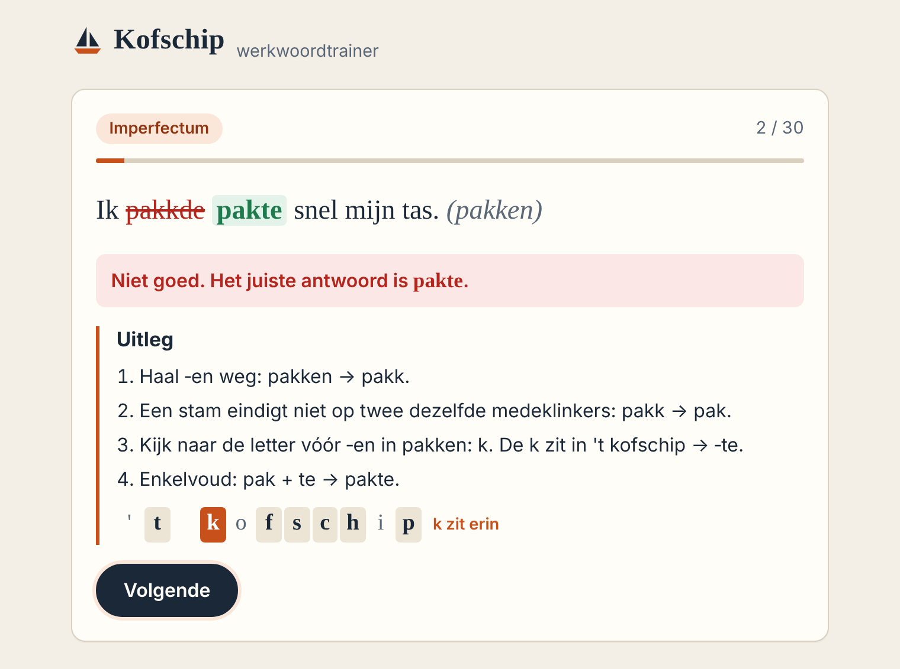

# Kofschip

[](https://github.com/TB3-01-Markov/kofschip/actions/workflows/ci.yml)

A trainer for Dutch verb forms, built for learners of Dutch as a second language (NT2).
You get a sentence with a blank, type the verb in the right tense, and the site explains
the answer rule by rule.

The name comes from *'t kofschip*, the mnemonic every Dutch pupil learns for choosing
between *-te* and *-de* in the past tense.



## What it does

- Three tenses: **presens** (*ik werk*), **imperfectum** (*ik werkte*) and **perfectum** (*ik heb gewerkt*).
- Sessions of 10, 20 or 30 sentences, drawn at random without repeats.
- After each answer: right or wrong, the correct form, and a step-by-step explanation.
- A result page with your mistakes, and a round with only those mistakes.
- Progress per tense, kept in the browser. No account needed.
- Works on a phone (from 360 px) and with the keyboard alone: type, Enter, Enter.

The interface is in Dutch, because that is the language its users are learning.

## How the forms are made

The 100 verbs in the database store only their infinitive. Every form is derived by
`ConjugationEngine`, which also records the rules it applied; those records are the
explanation the learner sees.

| Rule | Example |
| --- | --- |
| Stem = infinitive without *-en* | werken → werk |
| A long vowel is written double | maken → maak |
| No doubled consonant at the end | pakken → pak |
| *v* → *f*, *z* → *s* | leven → leef, reizen → reis |
| Unstressed *-el, -er, -en, -em* stays as it is | wandelen → wandel |
| Letter before *-en* in 't kofschip → *-te / -t*, otherwise *-de / -d* | werkte, woonde |
| The check uses the infinitive, not the stem | leven → leef**de** |
| Participle = *ge* + stem + *t/d*, no extra *t/d* | gewerkt, gepraat |
| No *ge-* after *be-, ver-, ont-, her-, er-, ge-* | betaald, verteld |
| Trema after *ge-* | geëindigd |
| Present tense: stem, stem + *t*, infinitive; no *t* in "werk jij" | werk, werkt, werken |

Two things cannot be read from the spelling, so the data can supply them:

- **Stress.** *luisteren* gives *luister*, but *proberen* gives *probeer*. Verbs of the second
  kind carry their stem in the seed file.
- **Look-alike prefixes.** *bedelen* starts with *be* but has no prefix. A flag in the data
  switches the detection off.

Strong and irregular verbs (*lopen – liep – gelopen*) are out of scope for the engine by
design: their forms have to be stored. They are planned for version 2.

## Architecture

```
src/
  Kofschip.Core   Domain model, conjugation engine, training session logic. No dependencies.
  Kofschip.Data   EF Core (SQLite): DbContext, migration, seed file, repository.
  Kofschip.Web    Blazor Web App (interactive server): pages, components, browser storage.
tests/
  Kofschip.Tests  xUnit: engine, session logic, seed data, database, web application.
```

- `Core` knows nothing about the web or the database. The data layer implements its
  `ISentenceSource` interface.
- The database is created and filled on first start: migrations run, then verbs from
  `Seed/verbs.json` that are not in the database yet are added.
- The web project uses `IDbContextFactory`, because a Blazor Server circuit outlives a
  normal request scope.
- Settings and progress are stored in `localStorage` through a small wrapper that fails
  softly when storage is unavailable.

## Run it

Requires the [.NET 10 SDK](https://dotnet.microsoft.com/download).

```bash
git clone https://github.com/TB3-01-Markov/kofschip.git
cd kofschip
dotnet run --project src/Kofschip.Web
```

Open the address shown in the console. The SQLite file `kofschip.db` appears next to the
project on first start.

## Tests

```bash
dotnet test
```

More than 370 tests:

- **Engine**: every rule in the table above, with its edge cases
  (*praatte*, *antwoordde*, *gered*, *geëerd*).
- **Seed data**: each of the 100 verbs is checked against hand-written forms, so a new
  verb that the rules get wrong fails the build.
- **Session logic**: answering, counting, retrying mistakes, settings, progress.
- **Database**: the real migration and seed on in-memory SQLite, including a check that
  the migration matches the model.
- **Web application**: the real `Program.cs` started with `WebApplicationFactory`.

GitHub Actions builds and tests every push and pull request, and attaches the published
site as the artifact `kofschip-web`.

## Adding a verb

1. Add it to `src/Kofschip.Data/Seed/verbs.json` with one sentence per tense. `___` marks
   the blank; `person` is the subject of the sentence.

   ```json
   {
     "infinitive": "kamperen",
     "stem": "kampeer",
     "sentences": [
       {"tense": "Presens", "person": "Wij", "text": "Wij ___ elke zomer in Frankrijk."},
       {"tense": "Imperfectum", "person": "Ik", "text": "Vorig jaar ___ ik aan zee."},
       {"tense": "Perfectum", "person": "Hij", "text": "Hij heeft nog nooit ___."}
     ]
   }
   ```

2. Add its forms to `tests/Kofschip.Tests/Data/ExpectedForms.cs`.
3. Run `dotnet test`. The verb is added to the database on the next start.

To change the schema, add a migration:

```bash
dotnet tool install --global dotnet-ef
dotnet ef migrations add <Name> --project src/Kofschip.Data
```

## Roadmap

- **Version 2**: strong verbs, choosing *hebben* or *zijn*, statistics per rule,
  practice of weak spots, a page with the rules.
- **Version 3**: accounts, an admin area for verbs and sentences, more tenses,
  separable verbs.
